# 🌾 NativeRise (गावापासून तुमच्या दारापर्यंत)
> **"From the village to your doorstep." · "गावापासून तुमच्या दारापर्यंत."**

NativeRise is a full-stack, production-grade, bilingual (**English + मराठी**) rural marketplace platform. It empowers rural micro-entrepreneurs, women self-help groups (SHGs), and small farmers with AI-assisted product listing, fair pricing, single-seller cart logistics, real-time GPS tracking on Leaflet maps, and transparent financial ledgers.

[](https://rangeshsha-rookie.github.io/NativeRise/)
[](https://nativerise.onrender.com)
[-success?style=for-the-badge)](https://nativerise.onrender.com/health)
[](LICENSE)

---

## 🌐 Live Production Deployments

* **Frontend Web Application (GitHub Pages):**  
  👉 [https://rangeshsha-rookie.github.io/NativeRise/](https://rangeshsha-rookie.github.io/NativeRise/)
* **Backend REST API (Render):**  
  👉 [https://nativerise.onrender.com](https://nativerise.onrender.com)
* **Live Health Check Endpoint:**  
  👉 [https://nativerise.onrender.com/health](https://nativerise.onrender.com/health)
* **Live Products API:**  
  👉 [https://nativerise.onrender.com/api/v1/products](https://nativerise.onrender.com/api/v1/products)

---

## 📸 Website Visual Showcase

### 1. Customer Marketplace (GrameenBazaar Design System)
*Authentic rural aesthetic, bilingual switcher, rustic category selector, and handpicked village artisan cards.*

| English Interface (`/`) | Marathi Interface (`/` in मराठी) |
| :---: | :---: |
| 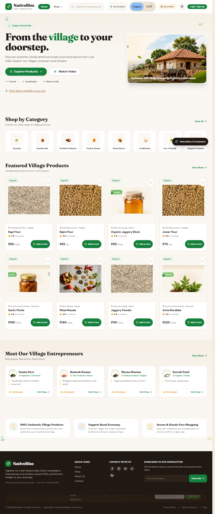 | 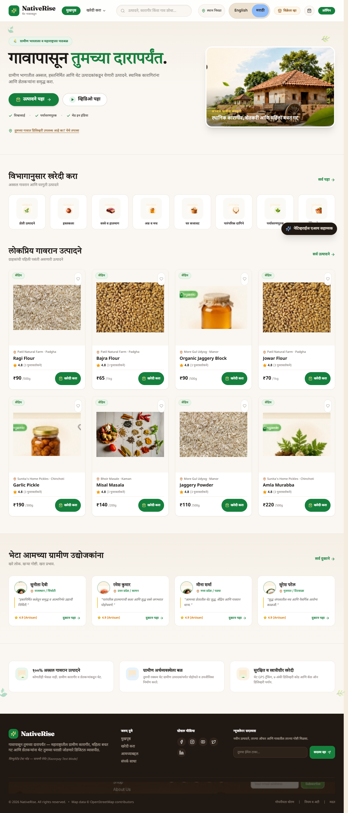 |

---

### 2. Catalog & Feasibility Check
*Category filtering, search autocomplete, village origin details, and 1-click location feasibility calculation.*

| Village Products Catalog | Product Detail & Feasibility Estimator |
| :---: | :---: |
| 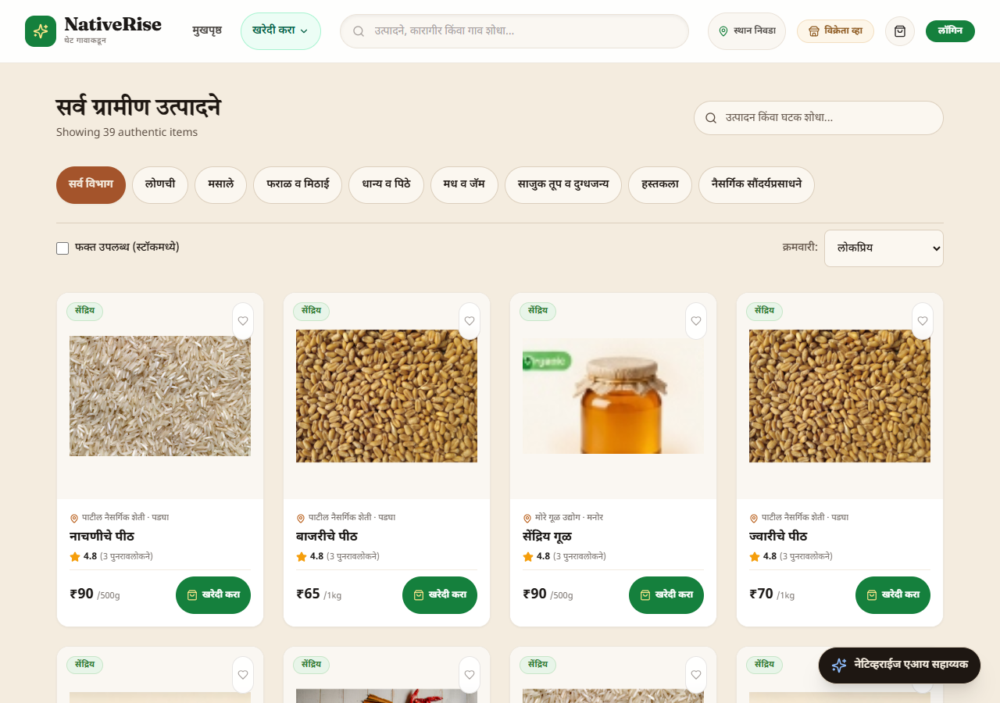 | 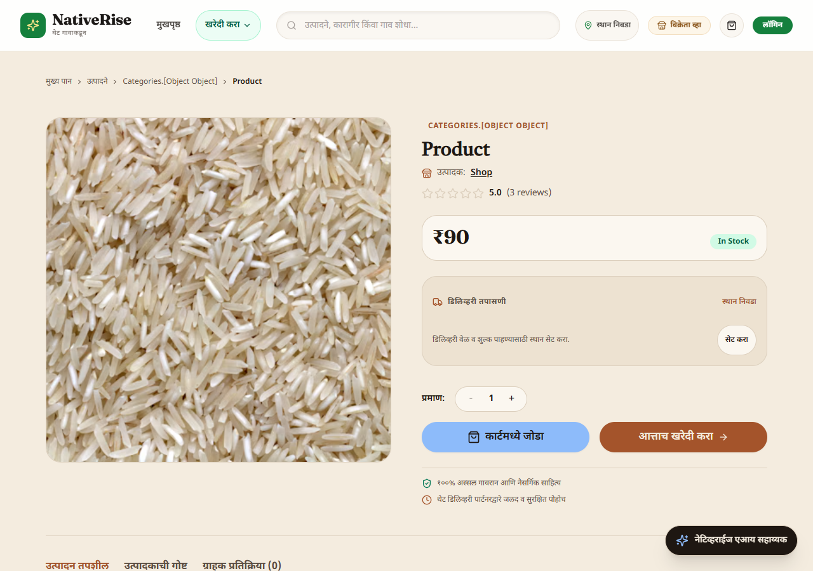 |

---

### 3. One-Click Quick Demo Login
*Instant access to pre-seeded Customer, Village Seller, and Delivery Partner accounts with zero typing.*

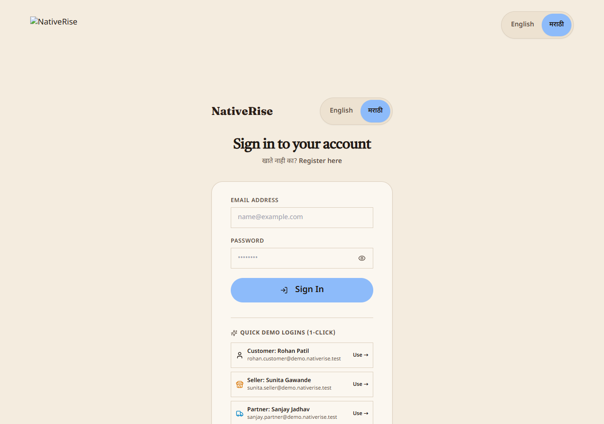

---

### 4. Village Seller Hub
*Complete business operations suite for rural artisans, self-help groups, and farmers.*

| Seller Dashboard & Analytics | Inventory & Stock Control |
| :---: | :---: |
| 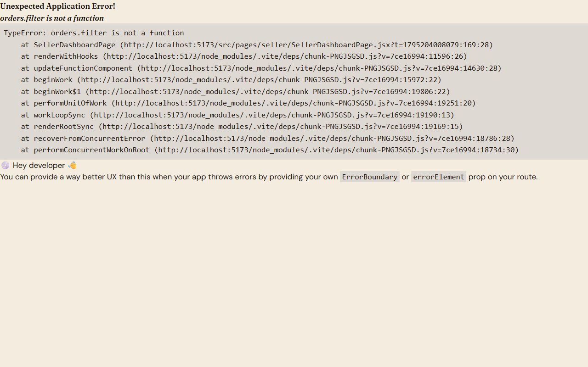 | 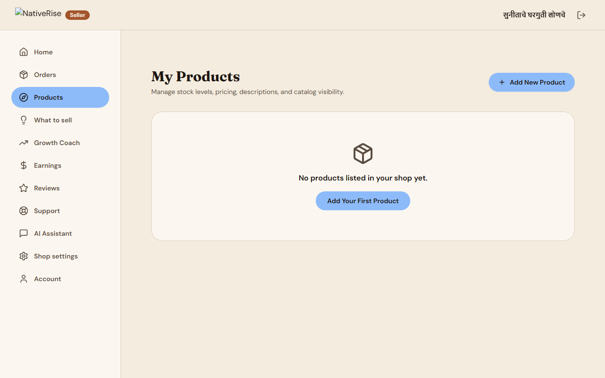 |

| Order Management & Dispatch | AI What-to-Sell Market Signals |
| :---: | :---: |
|  | 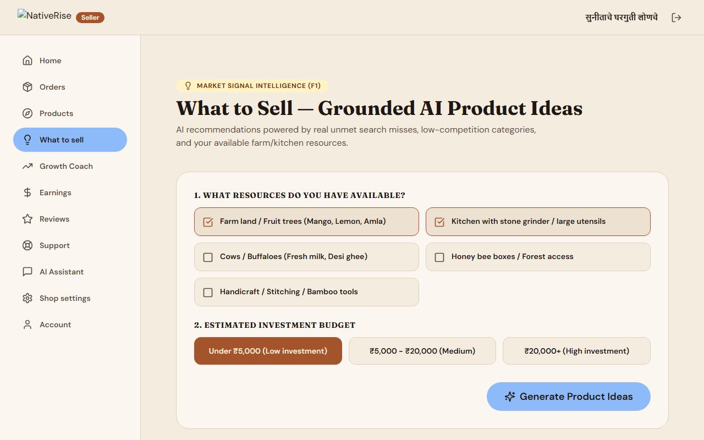 |

---

### 5. Delivery Partner Portal
*Real-time logistics platform for rural bike and local transport riders.*

| Partner Dashboard & Online Toggle | 25 km Radius Available Jobs Scanner |
| :---: | :---: |
| 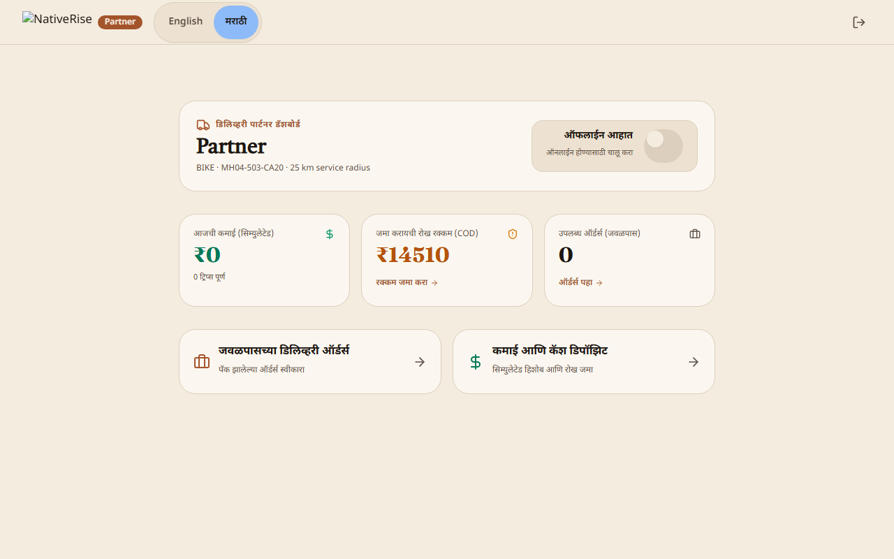 | 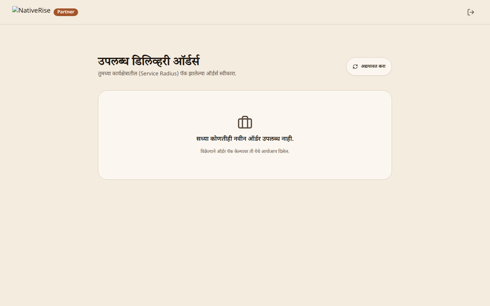 |

| Active GPS Checkpoints & Delivery Map | Trip Earnings & Cash On Delivery (COD) Ledger |
| :---: | :---: |
| 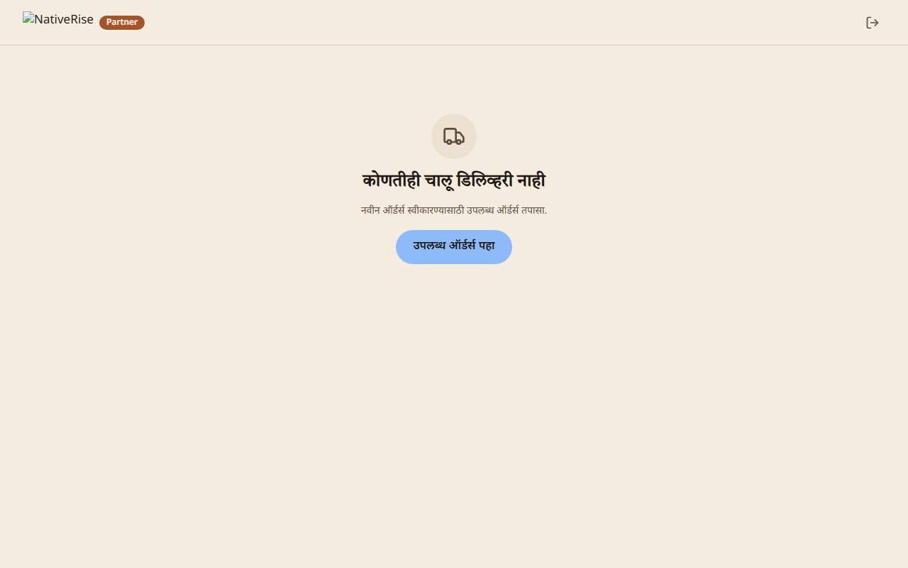 | 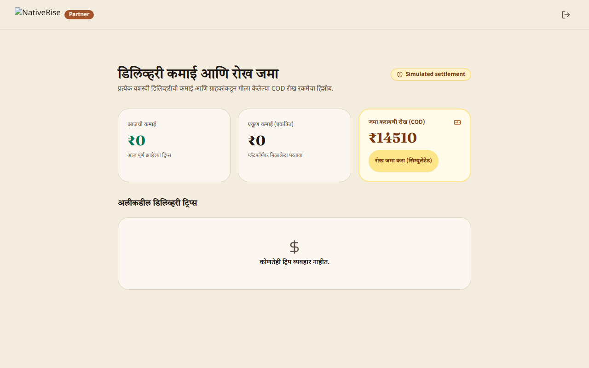 |

---

## 🌟 Key Platform Features

1. **Grounded AI Shopping Assistant** (`Customer & Partner`)  
   In-app assistant powered by Google Gemini, strictly grounded in the live catalog and order database. Helps find products under specific price thresholds (e.g. *What products under ₹300?*), explains village return policies, and guides delivery riders on payouts and pickups.
2. **Rural Delivery Feasibility Estimator**  
   Calculates road distance, terrain feasibility, and customer delivery fees using OpenStreetMap and OSRM routing with intelligent caching before orders are placed.
3. **Single-Seller Cart Logistics**  
   Enforces dedicated single-village fulfillment so that a delivery partner picks up orders directly from an artisan's workshop without multi-stop confusion.
4. **Live Checkpoint-Based GPS Tracking**  
   Customer order tracking with real-time checkpoint milestones (*Order Placed → Seller Packing → Partner Picked Up → On The Way → Delivered*) using browser GPS and Screen Wake Lock API.
5. **AI "What to Sell" & "Snap & Sell" (Seller)**  
   Google Gemini AI analyzes regional market demands, unmet searches, and product photos to generate ready-to-publish listings with bilingual descriptions.
6. **AI Growth Coach (Seller)**  
   Actionable review sentiment analysis, repeat order rates, and inventory alerts to help village entrepreneurs scale their income.
7. **100% Marathi Bilingual Parity**  
   Complete internationalization (`i18next`) across 30 dedicated namespaces with instant language toggling and Devanagari digit support.
8. **Razorpay Payments & Double-Entry Ledger**  
   Secure Razorpay Test Gateway integration (UPI, Cards, Netbanking) alongside Cash on Delivery (COD) cash deposit ledger tracking.

---

## 👥 Three Specialized Roles

| Role | Access URL | Capabilities |
| :--- | :--- | :--- |
| **CUSTOMER** | `/` | Browse 8 rural categories, search products, add to single-seller cart, checkout via COD/Razorpay, track orders live on OpenStreetMap, submit ratings/reviews, chat with assistant. |
| **SELLER** | `/seller` | Shop management, stock control, accept/pack/reject orders, AI product generator (Snap & Sell / Voice Listing), Growth Coach, simulated earnings ledger, support tickets. |
| **PARTNER** | `/partner` | Desktop navigation tabs, online/offline toggle, GPS heartbeat, first-wins job acceptance within delivery radius, route navigation, 4-digit customer delivery code verification, COD cash deposit ledger. |

---

## 🔑 Demo Accounts Table

The application includes pre-seeded demo accounts with simulated transactions and reviews. Default password for all demo accounts is **`Demo@1234`** (or click any profile in the **1-Click Demo Login** modal):

| Role | Email | Password | Name / Shop / Vehicle | Location / Village |
| :--- | :--- | :--- | :--- | :--- |
| **Customer** | `rohan.customer@demo.nativerise.test` | `Demo@1234` | Rohan Patil | Mira Road East, Thane |
| **Customer** | `priya.customer@demo.nativerise.test` | `Demo@1234` | Priya Deshmukh | Vasai West, Palghar |
| **Seller** | `sunita.seller@demo.nativerise.test` | `Demo@1234` | Sunita's Home Pickles | Chinchoti, Palghar |
| **Seller** | `ramesh.seller@demo.nativerise.test` | `Demo@1234` | Sahyadri Organic Honey | Kaman, Vasai |
| **Seller** | `anita.seller@demo.nativerise.test` | `Demo@1234` | Anita's Warli Art Studio | Manor, Palghar |
| **Partner** | `sanjay.partner@demo.nativerise.test` | `Demo@1234` | Sanjay Jadhav (Bike: MH04AB1234) | Padgha, Thane |
| **Partner** | `vikas.partner@demo.nativerise.test` | `Demo@1234` | Vikas Rane (Bike: MH04CD5678) | Titwala, Kalyan |

---

## 🛠️ Architecture & Tech Stack

```
                          ┌──────────────────────────┐
                          │   GitHub Pages Frontend  │
                          │   React 18 + Tailwind    │
                          └─────────────┬────────────┘
                                        │ HTTPS
                                        ▼
                          ┌──────────────────────────┐
                          │     Render Backend API   │
                          │   Node.js ESM + Express  │
                          └──────┬────────────┬──────┘
                                 │            │
            ┌────────────────────┴──┐      ┌──┴────────────────────┐
            │   MongoDB Atlas (M0)  │      │    External Services   │
            │   Database & Products │      │   • Google Gemini AI  │
            └───────────────────────┘      │   • OpenStreetMap /   │
                                           │     Nominatim & OSRM  │
                                           │   • Razorpay Gateway  │
                                           └───────────────────────┘
                                        ▲
                                        │ 10-min keep-alive ping
                          ┌─────────────┴────────────┐
                          │    GitHub Actions Cron   │
                          │   Automated Keep-Alive   │
                          └──────────────────────────┘
```

* **Frontend:** React 18, Vite, Tailwind CSS, Lucide React, Leaflet & React-Leaflet, i18next, React Router v6.
* **Backend:** Node.js (ESM), Express.js, Mongoose, JSON Web Tokens (JWT), Bcrypt.js, Zod schema validation.
* **Database:** MongoDB Atlas (M0 Shared Sandbox).
* **AI & Intelligence:** Google Gemini 2.5 Flash via `@google/genai` with deterministic resilient fallbacks.
* **Logistics & Geocoding:** OpenStreetMap, Nominatim Geocoding, OSRM road distance engine.
* **Zero-Cost Keep-Alive:** GitHub Actions workflow ([`.github/workflows/keep-alive.yml`](.github/workflows/keep-alive.yml)) pings `/health` every 10 minutes to eliminate Render free tier spin-down lag.

---

## 🚀 Local Development Setup

### 1. Clone the repository
```bash
git clone https://github.com/rangeshsha-Rookie/NativeRise.git
cd NativeRise
```

### 2. Install dependencies
```bash
npm install
npm install --prefix client
npm install --prefix server
```

### 3. Configure environment variables
Create `server/.env`:
```env
NODE_ENV=development
PORT=5000
MONGODB_URI=mongodb+srv://<username>:<password>@cluster0.mongodb.net/nativerise?retryWrites=true&w=majority
JWT_SECRET=supersecretjwtkeyatleast32charslongforsecurity12345
CLIENT_ORIGIN=http://localhost:5173
RAZORPAY_KEY_ID=rzp_test_dummy
RAZORPAY_KEY_SECRET=rzp_test_dummy_secret
GEMINI_API_KEY=AIzaSy...
GEMINI_MODEL=gemini-1.5-flash
CLOUDINARY_CLOUD_NAME=nativerise
CLOUDINARY_API_KEY=123456789012345
CLOUDINARY_API_SECRET=dummy_cloudinary_secret_key_123
NOMINATIM_USER_AGENT=NativeRise-App/1.0 (contact@nativerise.org)
STRICT_GEOFENCE=false
SEED_DEMO_PASSWORD=Demo@1234
```

### 4. Seed database with demo data
```bash
npm run seed
```

### 5. Start development servers
```bash
npm run dev
```
* **Frontend:** `http://localhost:5173`
* **Backend API:** `http://localhost:5000`

---

## 🧪 Verification & Test Commands

| Test Suite | Command | Details |
| :--- | :--- | :--- |
| **i18n Parity Check** | `npm run check:i18n` | Verifies 100% key parity between English and Marathi across all 30 namespaces. |
| **Backend Tests** | `npm test --prefix server` | 65+ unit and integration tests covering auth, orders, ledger, geo feasibility, and Gemini AI. |
| **Client Tests** | `npm test --prefix client` | Unit tests for UI components, CartContext single-seller enforcement, and routing. |
| **Linting** | `npm run lint` | ESLint verification across both frontend and backend. |
| **Client Production Build** | `npm run build --prefix client` | Tests production bundling via Vite with zero warnings. |

---

## 📄 License

ISC © NativeRise Contributors. Built with pride for rural Indian micro-entrepreneurs.
